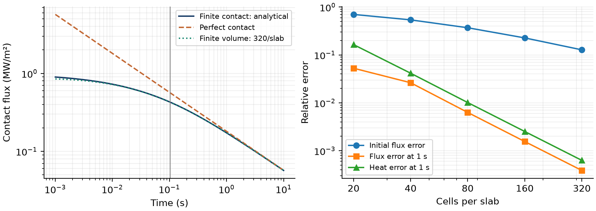

# ContactScale

**An accurate late-time heat flux can hide an unresolved thermal contact.**
ContactScale compares a conservative finite-volume model with an analytical
two-body contact solution. It separates contact physics, spatial resolution,
finite-domain effects and floating-point error, using modal propagation to
eliminate time-stepping truncation error.



[Academic manuscript (PDF)](paper/paper.pdf) · [LaTeX source](paper/paper.tex) ·
[Recorded results](results/metrics.json) · [Validation details](VALIDATION.md)

## What the experiment shows

For the stated synthetic pair of solids and contact resistance:

- The contact-to-diffusion crossover is **0.1024 s**.
- With 320 cells per slab, flux error at 1 s is **0.0387%**, but initial flux
  is underestimated by **12.78%**. Maximum flux error over the sampled
  0.001-10 s interval is **5.46%**.
- Late flux refinement approaches order **2.005**; the initial flux deficit
  follows a half-cell resistance effect.
- Perfect contact predicts **30.67% more heat** at 1 s than finite contact.
  That is a modeling difference, not a discretization error.

No experimental physical validation, novelty of the equations, or runtime
speedup is claimed. All values come from the committed reproducible study.

## Model and method

For each solid, with volumetric heat capacity `c` and conductivity `k`,

```text
c dT/dt = k d²T/dx²
q = -kL dTL/dx = -kR dTR/dx
TL(surface) - TR(surface) = R q
```

The interface has no heat capacity. The analytical bodies are semi-infinite,
initially uniform, with gap `Delta`. Define `e_i = sqrt(k_i*c_i)`,
`b = 1/e_L + 1/e_R`, `z = b*sqrt(t)/R` and `tc = (R/b)^2`.

```text
q(t) = Delta/R * erfcx(z)
Q(t) = Delta*sqrt(t)/b * [2/sqrt(pi) + (erfcx(z)-1)/z]
```

The implementation evaluates `erfcx` directly and uses a 20-term convergent
series for integrated heat when `z < 0.1`, avoiding small-argument cancellation.
The `R=0` branch is explicit; its flux at zero time is undefined and rejected.

The finite domain has insulated ends. For widths `h_j`, capacities are
`M_jj = c_j*h_j` and face conductances are
`g_j = 1/(h_j/(2*k_j) + R_j + h_(j+1)/(2*k_(j+1)))`.
The chain obeys `M Tdot = -K T`, with `K = B.T diag(g) B`.
`ThermalChain` diagonalizes the symmetric tridiagonal matrix `M^-1/2 K M^-1/2`.
The capacity-weighted mean is propagated analytically; fluctuations decay
exponentially. Eigensolver roundoff remains. Temperature states at zero time
are returned exactly as supplied.

At the initially sharp contact, `q_h(0)/q(0) = 1/(1+eta_h)`, where
`eta_h = [h_L/(2*k_L)+h_R/(2*k_R)]/R`. A small time step cannot repair a large
`eta_h`. The full derivation, algorithm and error interpretation are in the paper.

## Install and run

Python 3.11 or later; NumPy, SciPy and Matplotlib are the runtime dependencies.
No custom compiler is required. This project uses Python with SciPy's compiled
LAPACK core; other projects in the series implement custom C++ numerical cores.

```sh
python -m venv .venv
# Windows PowerShell: .venv\Scripts\Activate.ps1
# Linux/macOS: source .venv/bin/activate
python -m pip install -e ".[dev]"
contactscale --output results
python examples/quickstart.py
```

`contactscale --help` documents the CLI. `--output` chooses a directory; the
command overwrites only its fixed result filenames there. The experiment is
intentionally fixed in `src/contactscale/study.py`; use the API for new cases.
SI units are used throughout; heat and flux are per unit interface area.

```python
import numpy as np
from contactscale import Slab, contact_flux, two_slabs

left = Slab(length=0.06, conductivity=16, capacity=4e6)
right = Slab(length=0.03, conductivity=2, capacity=2e6)
model, face = two_slabs(left, right, cells=80, resistance=2e-4)
temperatures = model.evolve(np.repeat([500.0, 300.0], 80), [0, 0.1, 1])
flux = model.flux(temperatures[-1])[face]
surfaces = model.surface_temperatures(temperatures[-1], face)
reference = contact_flux(1, 200, left.effusivity, right.effusivity, 2e-4)
```

`Slab` validates positive finite properties. `ThermalChain(widths, conductivity,
capacity, contacts=None)` accepts arbitrary positive cell vectors and nonnegative
face resistances. It copies inputs and makes stored arrays read-only.
`evolve(initial, times)` returns `(number_of_times, number_of_cells)`; times
are a finite, nonnegative 1-D array and need not be sorted. `flux` and
`surface_temperatures` take one state vector. `contact_heat` returns integrated
heat and `contact_scale` returns the crossover time. Analytical time arrays may
have arbitrary shape. Invalid shapes or nonfinite physical inputs raise
`ValueError`; numerical breakdown can raise a SciPy or arithmetic exception.

## Verify and build

```sh
python -m pytest -q
ruff check .
ruff format --check .
python scripts/check_results.py
python -m build
```

The reproduction checker compares all metrics and **514 CSV rows** with the
recorded outputs; roundoff diagnostics have explicit absolute budgets rather
than meaningless equality requirements. It separately enforces convergence and
accuracy conditions. Wheels and source distributions are built in CI; the
installed wheel is tested as well as the source checkout.

## Manuscript

The original research-format paper has a maximum five-page build constraint.
Install TeX Live with `latex-extra`, `science`, `fonts-recommended`, and `lmodern`
packages, or install [Tectonic](https://tectonic-typesetting.github.io/).

```sh
python scripts/build_paper.py
# Or: python scripts/build_paper.py --engine /absolute/path/to/tectonic
python scripts/build_paper.py --verify
pdftoppm -scale-to 1400 -png paper/paper.pdf paper/build/page
```

Create `paper/build` before the rendering command. The build script compiles
LaTeX, rejects undefined references and overfull boxes, enforces the page count,
and records SHA-256 hashes of the PDF and eight manuscript/data inputs.
`--verify` checks those hashes. Regenerating `results` requires recompiling the
paper. CI independently compiles with pdfLaTeX and uploads every page for review.
PDF metadata and roundoff-level diagnostic values may differ between platforms.

## Scope and provenance

Primary source concepts: **DTU MMME, Modelling in Materials and Manufacturing
Engineering**, lectures 2-4: thermal resistance, heat diffusion, effusivity and
interface reconstruction. Inspected read-only on 19 October 2026. ATSA lecture 6
on hierarchical forecasting and MLSP chapter 5 on sampling and quantization were
also checked while rotating the series topic. No new lecture PDFs were found
relative to the prior inventory. No course files, solutions, exams, private
datasets or copied figures are published. Synthetic parameters were independently
chosen; they are not asserted properties of specific real materials.

Limitations: 1-D linear heat flow, fixed contact resistance, no contact storage,
latent heat, property variation, radiation, convection or mechanical coupling.
The semi-infinite reference applies before remote boundaries matter; the finite
model eventually equilibrates. The domain check is empirical at 10 s with the
reported spacing. Smooth convergence is not evidence of uniform convergence at
the initial discontinuity. Dense modal storage is O(N²); extreme floating-point
scales and nearly disconnected chains are outside the tested range. No parameter
inference, experimental dataset, or performance benchmark is included.

## Public references

- [NIST DLMF §7.12](https://dlmf.nist.gov/7.12): complementary error-function asymptotics.
- [SciPy erfcx](https://docs.scipy.org/doc/scipy/reference/generated/scipy.special.erfcx.html): scaled special-function evaluation.
- [SciPy eigh_tridiagonal](https://docs.scipy.org/doc/scipy/reference/generated/scipy.linalg.eigh_tridiagonal.html): symmetric tridiagonal eigensolver.

The contact relation and integrated-heat formula are derived in the manuscript.
References were checked on 19 October 2026. Code and original documentation are
distributed under the [MIT license](LICENSE).
